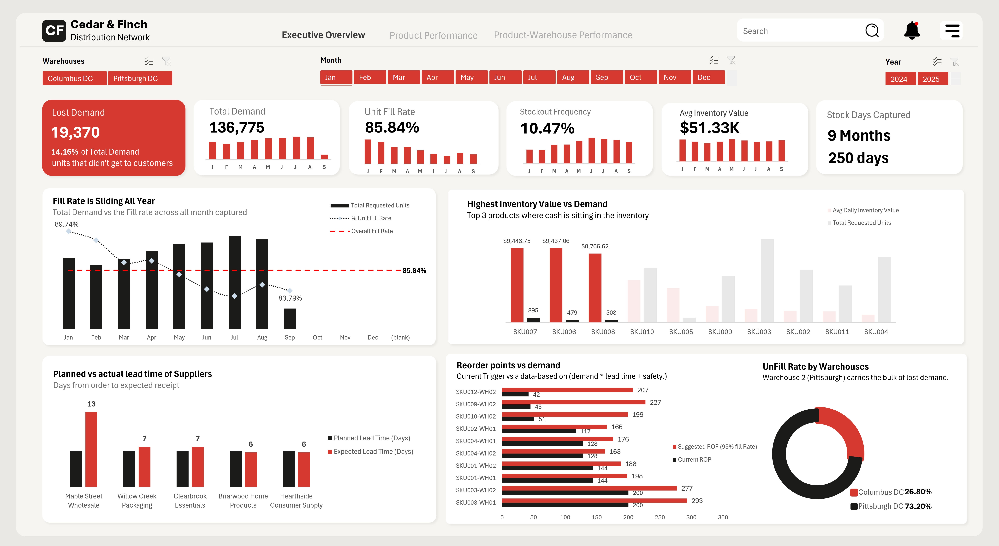
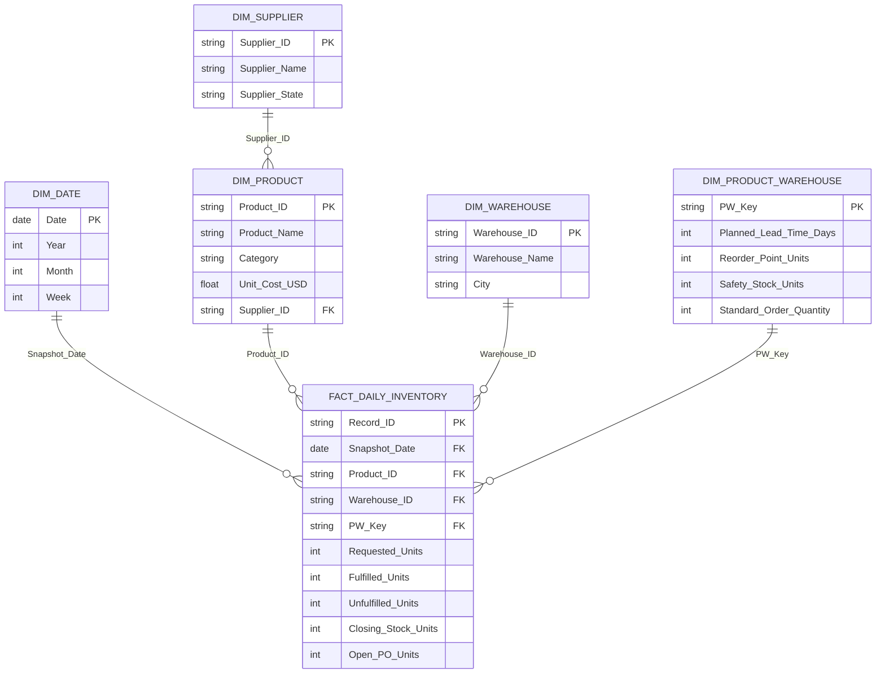

# Operation Stock Balance: Cedar & Finch Inventory Analysis

> Disclaimer: Cedar & Finch Distribution does not exist. Every product, warehouse and supplier named in this piece is a made-up name attached to simulated data. The data was built to simulate a real-life inventory problem for a group case study (Data With Danny, Cohort 9). Every figure in this article is real in the sense that I calculated it correctly from that data. Nothing else about it is real. Think of it as a fire drill for supply chain analytics: the alarms work, the fire doesn’t exist.

> *An Excel, Power Query, Power Pivot and DAX investigation into why a distributor runs out of stock while holding plenty of cash in inventory, and what it can change before buying more.*

**Project type:** End-to-end analysis (data cleaning and wrangling, data modelling, diagnostic analysis, interactive dashboard)


---

## Table of Contents
1. [Project Overview](#1-project-overview)
2. [Objectives](#2-objectives)
3. [Project Scope & Tools](#3-project-scope--tools)
4. [Repository Structure](#4-repository-structure)
5. [Data Workflow](#5-data-workflow)
6. [Data Model & Schema](#6-data-model--schema)
7. [Entity Relationship Diagram](#7-entity-relationship-diagram)
8. [Analysis & Metrics](#8-analysis--metrics)
9. [Key Insights](#9-key-insights)
10. [Recommendations](#10-recommendations)
11. [Assumptions & Limitations](#11-assumptions--limitations)
12. [Future Enhancements](#12-future-enhancements)
13. [Deliverables](#13-deliverables)
14. [Author](#14-author)

---

## 1. Project Overview

**Context:** Cedar & Finch Distribution (a simulated US distributor of household cleaning products, paper goods and home essentials) supplies retailers from two regional warehouses. At the year-end review, the Finance Director flagged that a lot of cash was tied up in inventory while the sales team kept reporting orders they couldn't fill.

**Problem Statement:** Why do stockouts and excess inventory exist at the same time, and can changes to replenishment settings or stock allocation improve availability without simply buying more?

**Approach:** My first approach is to cleaned 10,000 daily inventory records in Power Query, normalised the wide source table into a star schema in Power Pivot, and built DAX measures to test four suspected causes (reorder settings, supplier delays, stock in the wrong warehouse, and slow-moving stock) at product-warehouse level.

**Outcome:** All four signals were confirmed, but with very different weights. The cash needed to fix availability is already on the shelves: three slow-moving products hold more than half of inventory value against less than 1% of demand, while 54% of all lost demand could have been covered by stock sitting in the other warehouse. The main fixes are policy and allocation changes, not new purchasing.

---

## 2. Objectives

- **Primary Objective:** Determine why stockouts and excess inventory coexist across the Cedar & Finch network, and identify changes to replenishment and allocation that improve availability without increasing purchasing.
  
- **Secondary Objective 1:** Establish baseline KPIs (unit fill rate, stockout frequency, inventory value, turnover and days of cover) with clearly stated denominators.
  
- **Secondary Objective 2:** Build a clean, reproducible star schema with stated grains, unique keys and correct relationships.
  
- **Secondary Objective 3:** Test each of the four flagged signals against the data and quantify which products, warehouses and suppliers they affect.

> 💡 *Every analysis decision in this project traces back to one of these objectives.*

---

## 3. Project Scope & Tools

### Scope

| Dimension | Details |
|-----------|---------|
| **In Scope** | Daily inventory, customer-demand and replenishment records for 20 products across 2 warehouses (Columbus DC, and Pittsburgh DC) and 5 suppliers. Analysis covers availability, inventory value, reorder settings, supplier lead times and inter-warehouse imbalance. |
| **Out of Scope** | Revenue, margin, holding-cost and transfer-cost analysis: selling prices, margins, holding-cost rates and transfer costs are not in the dataset, so all value figures are at unit cost. A full supplier delivery audit is also out of scope because the data has no purchase-order IDs. |
| **Time Period** | 1 January – 7 September 2025 (250 days). The brief describes a full year, but the extract supplied is partial-year. |
| **Granularity** | One row per product, per warehouse, per day (10,000 rows = 20 products × 2 warehouses × 250 days). |

### Tools & Technologies

| Category | Tool(s) Used |
|----------|-------------|
| Data Storage | Excel workbook (.xlsx) |
| Data Processing | Power Query (M) |
| Data Modelling | Power Pivot / Excel Data Model |
| Analysis | DAX measures, PivotTables |
| Visualization | Excel dashboard (PivotCharts and slicers) |
| Version Control | Git / GitHub |
| Documentation | Markdown, PDF report, PowerPoint Presentation |

---

## 4. Repository Structure

```
operation-stock-balance/
│
├── data/
│   └── raw/
│       └── Cedar_Finch_Inventory_Raw_Dataset.xlsx    # Original source data, never edited
│   └── processed/
│       └── Cedar Finch Inventory Analysis.xlsx    # Power Query steps, Data Model, DAX, analysis and dashboard       
│
├── reports/
│   ├── OperationStockBalance_Report.pdf      # Written report
│   └── Cedar Finch KPI DAX_Reference.pdf            # KPI definitions and DAX measures
│
├── visuals/
│   ├── data_model.png                # Power Pivot diagram view
│   └── FP1.png                       # Executive Overview
│   └── FP2.png                       # Product Performance 
│   └── FP3.png                       # Product-Warehouse Performance
│
├── docs/
│   └── Cedar_Finch_Inventory_Case_Study_Brief.pdf   # Original case brief
│
└── README.md
```

---

## 5. Data Workflow

```
Raw Excel extract (Cedar Finch Inventory Raw Data, 10,000 rows × 34 columns)
      ↓
Power Query: reference query off the raw table (source preserved)
      ↓
Cleaning: trim, standardise labels, fix types, impute supplier state
      ↓
Normalisation: 1 fact table + 5 dimension tables in Power Pivot
      ↓
DAX measures: baseline KPIs and four-signal diagnostics
      ↓
Interactive Excel dashboard + written PDF report
```

1. **Source:** A single wide Excel sheet (`Cedar Finch Inventory Raw Data`) of synthetic teaching data: 10,000 rows, 34 columns, covering 20 products, 2 warehouses and 250 days. A `ReadMe` and `Data_Dictionary` sheet came with it.
2. **Ingestion:** Loaded into Power Query from the workbook table. All cleaning runs on a reference query, so the raw table is never changed.
3. **Cleaning:** The scan found four real data-quality issues:
   - `Product_Name`: 150 rows with leading/trailing spaces → Trim and Clean.
   - `Category`: 113 rows in upper case (CLEANING, HOUSEHOLD, PAPER GOODS) → standardised to proper case.
   - `Unit_Cost_USD`: 100 values stored as text → type set to Decimal Number.
   - `Supplier_State`: 73 blanks → imputed from the supplier's one known state, with a `State_Imputed` flag. No rows deleted.

   The three `Next_PO_*` date columns are blank on exactly the 5,464 rows where `Open_PO_Units = 0`. That means "not applicable", not missing data, so they were left blank.
4. **Transformation:** Built dimension tables as reference queries (keep columns → remove duplicates), created a composite `PW_Key` (`Product_ID & "-" & Warehouse_ID`) for product-warehouse policy settings, and added a dedicated date table.
5. **Reconciliation checks (all passed):**
   - Closing = Opening + Received + Transfer In − Transfer Out − Fulfilled + Adjustment → 0 mismatches.
   - Unfulfilled = Requested − Fulfilled → 0 mismatches. Fulfilled never exceeds Requested, and there is no negative stock.
   - PO date blanks match `Open_PO_Units = 0` one-to-one (5,464 each).
6. **Analysis:** DAX measures for baseline KPIs, then product-warehouse segmentation to test each of the four signals.
7. **Output:** Excel workbook (model, measures, dashboard), a written PDF report and a KPI/DAX reference.

---

## 6. Data Model & Schema

Star schema with 1 fact table and 5 dimensions. Every relationship is one-to-many and filters in one direction.

### Fact table: `Fact_Daily_Inventory`
**Grain:** one product, in one warehouse, on one day.

| Field Name | Data Type | Description | Example Value |
|------------|-----------|-------------|---------------|
| `Record_ID` | string | Unique source record identifier | CF000001 |
| `Snapshot_Date` | date | Day the record describes | 2025-01-01 |
| `Product_ID` | string | Foreign key to `Dim_Product` | SKU001 |
| `Warehouse_ID` | string | Foreign key to `Dim_Warehouse` | WH01 |
| `PW_Key` | string | Foreign key to `Dim_Product_Warehouse` | SKU001-WH01 |
| `Opening_Stock_Units` | int | Units on hand at start of day (snapshot) | 140 |
| `Received_Units` | int | Units received from suppliers that day | 0 |
| `Transfer_In_Units` / `Transfer_Out_Units` | int | Units moved between warehouses | 0 |
| `Fulfilled_Units` | int | Customer demand actually shipped | 13 |
| `Adjustment_Units` | int | Stock corrections | 0 |
| `Closing_Stock_Units` | int | Units on hand at end of day (snapshot) | 127 |
| `Requested_Units` | int | Total customer demand that day | 13 |
| `Unfulfilled_Units` | int | Demand lost to stockouts | 0 |
| `Customer_Order_Count` | int | Number of customer orders | 3 |
| `Open_PO_Units` | int | Units on order but not yet received (snapshot) | 252 |
| `Next_PO_Order_Date` / `Promised_Date` / `Expected_Date` | date | Next open PO dates; blank when no PO is open | 2025-01-05 |

### Dimension tables

| Table | Rows | Key | Main attributes |
|-------|------|-----|-----------------|
| `Dim_Date` | 250+ (extended to cover PO dates) | `Date` | Year, Month, Month Name, Week, Day |
| `Dim_Product` | 20 | `Product_ID` | Product_Name, Category, Subcategory, Unit_of_Measure, Unit_Cost_USD, Supplier_ID |
| `Dim_Warehouse` | 2 | `Warehouse_ID` | Warehouse_Name, City, State |
| `Dim_Supplier` | 5 | `Supplier_ID` | Supplier_Name, Supplier_State, State_Imputed |
| `Dim_Product_Warehouse` | 40 | `PW_Key` | Planned_Lead_Time_Days, Reorder_Point_Units, Safety_Stock_Units, Standard_Order_Quantity, Minimum_Order_Quantity |

> **Row count:** 10,000 fact rows
> **Date range:** 1 Jan 2025 – 7 Sep 2025
> **Key joins:** `Fact.Product_ID → Dim_Product`, `Fact.Warehouse_ID → Dim_Warehouse`, `Fact.PW_Key → Dim_Product_Warehouse`, `Fact.Snapshot_Date → Dim_Date`, `Dim_Product.Supplier_ID → Dim_Supplier`

**Modelling notes**
- Reorder points, safety stock, lead times and order quantities are constant per product-warehouse pair, so they live in `Dim_Product_Warehouse` rather than being repeated 250 times on the fact.
- The three PO dates relate to `Dim_Date` through inactive relationships and are switched on inside individual measures with `USERELATIONSHIP`. This avoids building three separate date tables.
- `Closing_Stock_Units` and `Open_PO_Units` are snapshot balances. Measures average them over time (or take the last value) and never sum them across dates.

---

## 7. Entity Relationship Diagram



**Table Relationships Summary:**

| Relationship | Join Key | Type |
|-------------|----------|------|
| `Fact_Daily_Inventory` → `Dim_Date` | `Snapshot_Date` | Many-to-One (active) |
| `Fact_Daily_Inventory` → `Dim_Date` | `Next_PO_*` dates | Many-to-One (inactive, used via `USERELATIONSHIP`) |
| `Fact_Daily_Inventory` → `Dim_Product` | `Product_ID` | Many-to-One |
| `Fact_Daily_Inventory` → `Dim_Warehouse` | `Warehouse_ID` | Many-to-One |
| `Fact_Daily_Inventory` → `Dim_Product_Warehouse` | `PW_Key` | Many-to-One |
| `Dim_Product` → `Dim_Supplier` | `Supplier_ID` | Many-to-One |

---

## 8. Analysis & Metrics

### Analytical Approach

The brief listed four possible causes, none of them confirmed. We treated each one as a hypothesis and tested it at product-warehouse level, after setting a network baseline. The work ran from descriptive (what is happening), to diagnostic (why), to prescriptive (what-if changes to reorder points and transfers). Every recommendation had to consider reallocation and policy changes before any new purchasing.

**Network baseline (Jan–Sep 2025):**

| KPI | Value |
|-----|-------|
| Requested units | 136,775 |
| Fulfilled units | 117,405 |
| Unfulfilled (lost) units | 19,370 |
| Unit fill rate | 85.8% |
| Stockout frequency | 10.5% of product-warehouse-days |
| Average daily inventory value (at cost) | ~$51,325 |
| Days of cover (network) | ~24 days |

### Key Metrics Defined

| Metric | Plain-Language Definition | Why It Matters |
|--------|--------------------------|----------------|
| Unit Fill Rate | Fulfilled units divided by requested units | Shows how much customer demand was actually met. Requested demand is kept separate from fulfilled sales. |
| Stockout Frequency | Share of product-warehouse-days with any unfulfilled demand | Shows how often customers hit an empty shelf, not just how many units were lost |
| Inventory Value | Closing units × fixed unit cost, averaged across days (never summed across dates) | Measures how much cash is tied up in stock |
| Days of Cover | Average inventory value divided by average daily cost of fulfilled units | Shows how long current stock would last. High cover with low demand means slow-moving stock. |
| Suggested Reorder Point (95%) | Average daily demand × lead time + 1.645 × demand standard deviation × √lead time | A data-based benchmark for checking whether current reorder points are set too low |
| Transfer-Recoverable Demand | Lost units on days when the other warehouse held the same product above its reorder point | Measures how much lost demand was an allocation problem rather than a supply problem |
| Supplier Lead-Time Slip | Expected PO arrival date minus promised date, across distinct open POs | Tests whether supplier delays explain shortages |

### Methods Used

- Descriptive KPIs with defined time periods and denominators
- Segmentation by product, category, warehouse, supplier and month
- Comparison of current reorder points against a calculated 95% service-level reorder point
- Matching shortage days in one warehouse to surplus days in the other, by product and date
- Supplier analysis of planned vs. expected lead times across 617 distinct open POs (de-duplicated by product-warehouse and order date)
- Pareto-style concentration analysis (share of inventory value vs. share of demand)
- `USERELATIONSHIP`, `CALCULATE` and time-intelligence DAX for PO-date and snapshot measures

---

## 9. Key Insights

**Insight 1: Reorder points are set too low for 12 of 40 product-warehouse pairs, and this is the biggest driver of stockouts.**
These 12 pairs average an 81.3% fill rate compared with 94.1% for the rest. The worst gaps are all at the Pittsburgh warehouse (WH02): SKU009 Disinfecting Wipes has a reorder point of 45 against a data-based 226 (53% fill rate), and SKU012 Hand Soap has 42 against 206 (56% fill rate). SKU010 and SKU011 follow the same pattern. This is a policy-setting problem, not a demand shock.

**Insight 2: More than half of lost demand could have been met from the other warehouse.**
On 552 product-days, one warehouse ran short while the other held the same product above its reorder point. That adds up to 10,536 units, or 54% of all lost demand. The same four products (SKU009–SKU012) account for most of it. The network has the stock; it is just in the wrong place.

**Insight 3: Three slow movers tie up more than half of the cash in inventory.**
The top five products hold about 73% of inventory value but only about 9% of demand. SKU006 Stone Care Kit, SKU007 Deluxe Storage Bin and SKU008 Linen Spray Gift Set each hold 17–18% of value while making up less than 1% of demand, with 94–180 days of cover. Meanwhile fast movers like SKU001 Dish Soap and SKU003 Paper Towels run on only 4–5 days of cover.

**Insight 4: Supplier delays are real but limited to one supplier, and they are not behind the main stockouts.**
Maple Street Wholesale (SUP04) delivers in about 13.5 days against a planned 7, with 88% of POs late and an average slip of 6.5 days. The other four suppliers are late on 12% of POs or fewer, with average slips under 0.3 days. The worst stockout products (SKU009–SKU012) come from Clearbrook Essentials, which delivers on time. So the main availability problem is policy and allocation, not supply.

---

## 10. Recommendations

| Priority | Recommendation | Based On | Suggested Owner |
|----------|---------------|----------|-----------------|
| High | Reset reorder points and safety stock for the 12 under-set product-warehouse pairs, starting with SKU009–SKU012 at WH02, using the 95% service-level formula. Monitor fill rate and stockout frequency monthly. | Insight 1 | Purchasing / Inventory Planning |
| High | Introduce an inter-warehouse transfer rule for SKU009–SKU012: when one site falls below its reorder point and the other is above, transfer before raising a new PO. Could recover up to ~10.5k units without new buying (before transfer costs, which are not in the data). | Insight 2 | Warehouse Operations / Logistics |
| High | Run down stock of SKU006, SKU007 and SKU008: pause replenishment until cover falls to target, and use the released cash to cover fast movers. | Insight 3 | Purchasing / Finance |
| Medium | Re-plan Maple Street Wholesale (SUP04) at a 13–14 day lead time and open a supplier performance review. Track percentage of POs late and average slip. | Insight 4 | Procurement / Supplier Management |

---

## 11. Assumptions & Limitations

### Assumptions
- Demand roughly follows a normal distribution, and a 95% service level (z = 1.645) is an appropriate target for the suggested reorder points.
- Unit cost is fixed for the whole period, as stated in the dataset ReadMe.
- Unfulfilled demand is lost, not backordered. Days with zero sales may mean zero demand or no stock.
- Each supplier has exactly one true state, so blank `Supplier_State` values can be safely imputed from the supplier ID.
- Transfers take one day in transit, and units in transit are not counted as warehouse stock.

### Limitations
- **Synthetic data:** all company, product and supplier records are fictional teaching data.
- **Partial year:** the extract covers 1 Jan – 7 Sep 2025, so it cannot show full annual seasonality.
- **No PO IDs:** supplier lead times are estimated from open-PO snapshots, so this is not a complete delivery audit.
- **No prices, margins, holding costs or transfer costs:** all value figures are at unit cost. The benefits of transfers and stock rundowns are given in units, not profit.
- **Scenario benefits are estimates:** recovered-unit figures show what was possible in hindsight, not guaranteed future results.

---

## 12. Future Enhancements

- [ ] Add selling prices, holding-cost rates and transfer costs so the transfer and rundown recommendations can be valued in profit, not just units.
- [ ] Re-run the analysis on a full 12-month extract to test seasonality and set seasonal reorder points.
- [ ] Use PO-level data with PO IDs to replace the snapshot-based supplier view with a true delivery audit.
- [ ] Turn the transfer rule into a daily exception report that flags product-warehouse pairs below reorder point while the other site is in surplus.

---

## 13. Deliverables

| Deliverable | Description | Location |
|-------------|-------------|----------|
| Analysis workbook | Power Query cleaning steps, star-schema Data Model, DAX measures, signal analysis and interactive dashboard | `/workbook/DWD_C09_Group03_StockBalance.xlsx` |
| Written report | Business objective, methodology, model design, insights, recommendations, limitations and group contributions | `/reports/DWD_C09_Group03_StockBalance_Report.pdf` |
| KPI & DAX reference | Plain-language KPI definitions and the DAX behind each measure | `/reports/Cedar_Finch_KPI_DAX_Reference.pdf` |
| Model diagram | Power Pivot diagram view of the star schema | `/visuals/data_model.png` |

---

## 14. Author

**Anuhi**
Associate Project Manager (CAPM) | Data Analytics Instructor
Team Lead, Group 03, Data With Danny Cohort 9 (10-member team)

- 🔗 [LinkedIn URL]
- 💼 [Portfolio or GitHub profile URL]
- 📧 [Email - optional]

---

*Last updated: November 2026*
